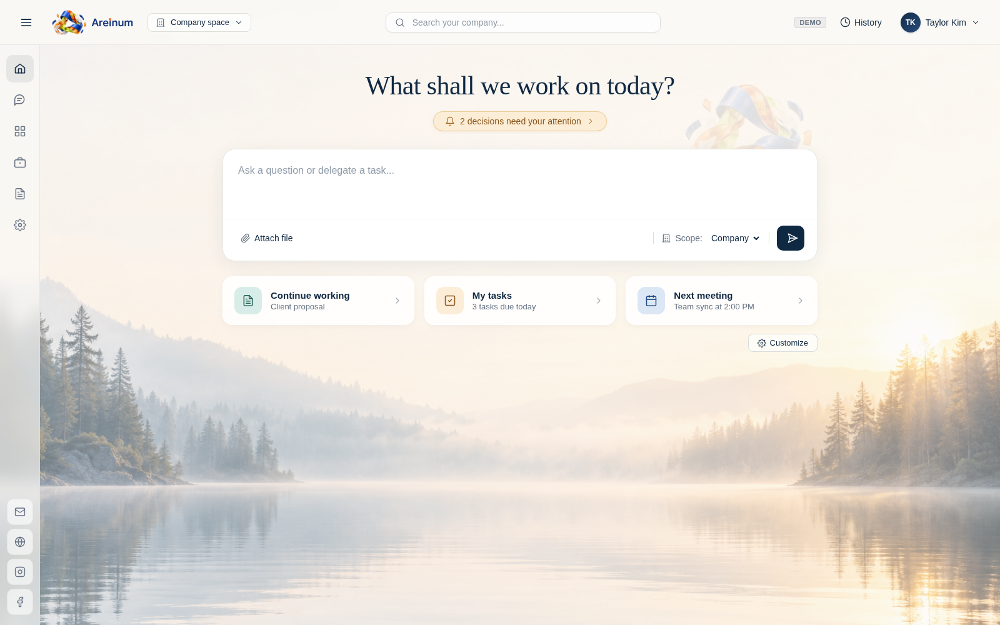
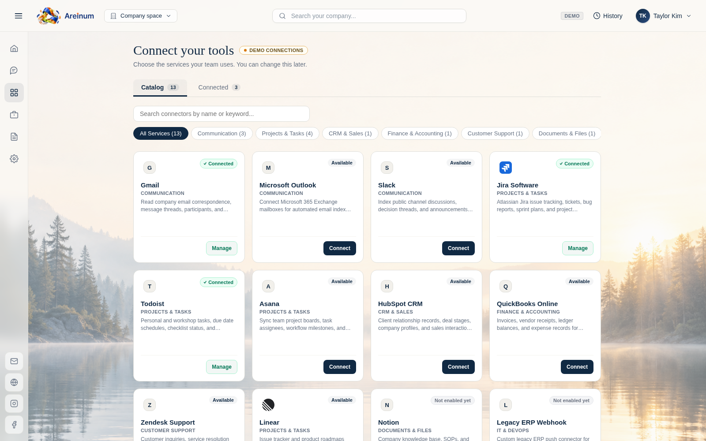
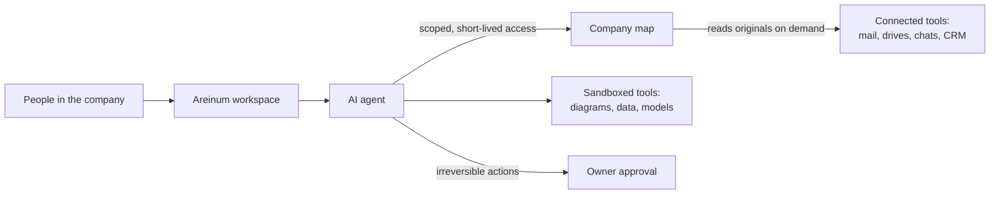

# Areinum

**[areinum.com](https://areinum.com)**

Areinum is an AI agent workspace for small companies with 1 to 25 people. It works on the company's own data (mail, drives, chats, projects and CRM) without copying that data into the AI.

You ask a question or hand off a task in plain language. The agent finds the right records across your connected tools, reads the originals only when it needs them, and comes back with the result: an answer with sources, a diagram, a data query, a financial model or a report. Anything irreversible waits for the owner's approval.

Security comes first in how Areinum is built. Each company's data is kept apart, the AI gets only the access a task needs, and nothing irreversible happens without the owner's consent.

> **Status:** early-stage. This repository is a public overview of the product. The platform itself is closed source, and there's no source code here.

## Today

### Product

- Chat with an agent that knows your company. Questions and tasks run against your connected accounts, limited to what the person asking is allowed to see.
- Areinum keeps a private map of where your company's information lives. The agent reads the original record when it needs it and never holds a bulk copy of your mail or files.
- Connect mail, calendars, drives, chats, project tools and CRM. You choose what to connect and can disconnect at any time.
- Built-in tools make diagrams and images, query tabular data, build financial models and reconcile records. Results come with previews, and with plain warnings when the output isn't perfect.
- Automations run recurring tasks on a schedule and put the results in the company space.
- Team management covers owner, admin and member roles, access per source, invite links and display names.
- The interface is in English, Polish, German and French.

### Security

- Every company's data, map and keys are separate, and every request is checked against the caller's company and current permissions.
- The agent never gets a dump of your data. Each task gets short-lived access limited to the asking person's permissions.
- Sign-in goes through your identity provider (OpenID Connect), and owners and admins must use a second factor.
- Sending, deleting, paying or publishing needs the owner's approval with a fresh second factor. The owner can also lock the data layer at once if something looks wrong.
- Passwords, API keys and private keys are detected and refused before they reach the AI or the chat history.
- Each run of a built-in tool is locked in its own Linux namespaces with no network, no privileges and hard limits on CPU, memory and time. It sees only its own input.
- Connections and stored secrets are encrypted. Backups are encrypted too, and an automated drill tests the restore.
- An audit trail records who did what, without storing the content of messages or secrets.
- Every change has to pass more than 4,000 automated tests, lint with warnings as errors, secret scanning and dependency vulnerability audits.

Found a security issue? See [SECURITY.md](SECURITY.md).

## Planned

- Hosting in Canada and the United States, so each customer's data can stay in its own country.
- Nightly encrypted backups to a separate server in production.
- Built-in tools for documents, spreadsheets and slides.

## How it works

1. The owner connects the company's tools. Areinum builds a private map of what exists and where, and that map belongs to one company only.
2. Someone asks a question or delegates a task. The agent gets short-lived access that matches that person's current permissions, and when their permissions change, the access changes too.
3. The agent reads only what it needs, from the original source, and cites where each answer came from.
4. Anything irreversible (sending, deleting, paying, publishing) needs the owner's explicit approval with a fresh second factor.

## Under the hood

- The backend is written in Rust with Axum and Tokio: about 60 crates and about 420,000 lines of Rust, roughly 40% of it tests.
- The frontend uses React 19 and TypeScript.
- Product data lives in PostgreSQL.
- Each built-in tool is a separate program that runs in its own sandbox with its own resource limits.

## Who it's for

Owners and small teams at accounting firms, agencies, consultancies and trades who want an assistant that understands their whole business, and who won't hand their data to a tool they can't control.

## Who builds it

Matt Zamrozniak, Areinum's founder, builds it in Toronto, Canada. You can reach Matt at [zxdubx@gmail.com](mailto:zxdubx@gmail.com), on [zsoxi.com](https://zsoxi.com) or on X as [@zxdubx](https://x.com/zxdubx).

## Contact

Want early access or a demo? Write to [clara@areinum.com](mailto:clara@areinum.com).

---

Areinum is developed with AI assistance (Claude, GPT agents) under the maintainer's review.

© 2026 Areinum. All rights reserved. See [LICENSE](LICENSE).
