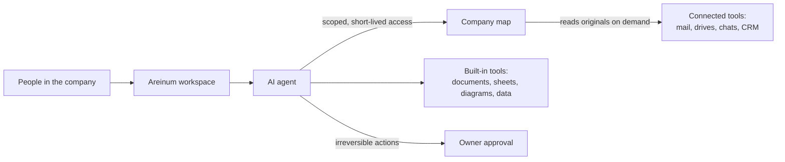

# Areinum

**Areinum is an AI agent workspace for small companies (1–25 people) that works on the company's own data — mail, drives, chats, projects and CRM — without copying that data into the AI.**

Ask a question or delegate a task in plain language. The agent finds the right records across your connected tools, reads the originals only when it needs them, and prepares the result: an answer with sources, a document, a sheet, a diagram or a report. Anything irreversible waits for the owner's approval.

> **Status:** pre-production. This repository is a public overview of the product. The platform itself is closed source; this repository contains no source code.

## What it does

- **Chat with an agent that knows your company.** Questions and tasks run against your connected accounts, scoped to what the person asking is allowed to see.
- **A map of your company, not a copy of it.** Areinum keeps a private map of where information lives. The agent reads the original record on demand instead of holding a bulk copy of your mail or files.
- **Connections to the tools you already use.** Mail, calendars, drives, chats, project tools, CRM and accounting. You choose what to connect, and you can disconnect at any time.
- **Work products, not just answers.** Built-in tools create and convert documents, sheets, diagrams and images, query tabular data, build financial models and reconcile records. Results carry previews and plain warnings where the output is not perfect.
- **Automations.** Recurring tasks run on a schedule, and their results land in the company space.
- **Team management.** Owner, admin and member roles, per-source access, invite links and display names.
- **Four languages:** English, Polish, German and French.

## How it works

1. **The owner connects company tools.** Areinum builds a private map of what exists and where. The map belongs to one company only.
2. **A person asks or delegates.** The agent receives short-lived, scoped access that matches that person's current permissions. When permissions change, access changes with them.
3. **The agent reads only what it needs,** from the original source, and cites where each answer came from.
4. **Anything irreversible** — sending, deleting, paying, publishing — needs the owner's explicit approval with a fresh second factor.

## Security and privacy

- **Isolation by design.** Every company's data, map and keys are separate, and every request is checked against the caller's company and permissions.
- **No bulk copies for the AI.** The agent never receives a dump of your data; reads are scoped and short-lived.
- **Strong sign-in.** Single sign-on with your identity provider, plus a required second factor for owners and admins.
- **Owner in control.** Irreversible actions need owner approval, and the owner can lock the data layer at once if something looks wrong.
- **Secrets stay out of the chat.** Passwords, API keys and private keys are refused before they reach the AI or the history.
- **Isolated tools.** Built-in tools run in a locked-down sandbox with no network and no access to anything except their own input.
- **Encryption and backups.** Encrypted connections and encrypted secrets; nightly encrypted backups with tested restores.
- **Audit trail.** Who did what is recorded, without storing the content of messages or secrets.
- **Hosting.** Planned in Canada and the United States, so each customer's data can stay in its own country.
- **Continuous checks.** Every change goes through an automated gate: thousands of tests, dependency vulnerability scans and secret scanning.

Found a security issue? See [SECURITY.md](SECURITY.md).

## Who it is for

Owners and small teams who want an assistant that understands their whole business — accounting firms, agencies, consultancies and trades — and who will not hand their data to a tool they cannot control.

## Contact

Interested in early access or a demo? Write to [clara@areinum.com](mailto:clara@areinum.com).

---

Areinum is developed with AI assistance (Claude, GPT agents) under the maintainer's review.

© 2026 Areinum. All rights reserved. See [LICENSE](LICENSE).
